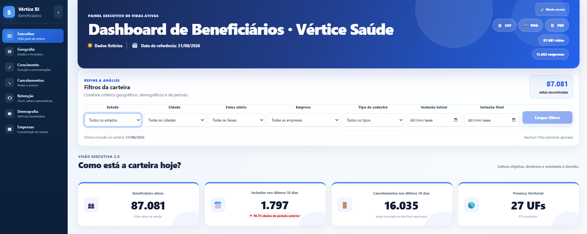

# Dashboard de Beneficiários · Operadora de Saúde

Análise da carteira de vidas de uma operadora de planos de saúde, **do SQL ao produto final**: a mesma base é tratada e analisada em **SQL (PostgreSQL)**, **Python**, **Power BI** e publicada como um **dashboard web interativo**.

> ⚠️ **Todos os dados deste repositório são fictícios.** A operadora "Vértice Saúde", as empresas, os planos e os beneficiários foram gerados para demonstração, mantendo a estrutura e os padrões de uma base real. Nenhum dado real de pessoas ou empresas é exibido.

🔗 **Dashboard:** (https://dashboard-beneficiarios.netlify.app/) · 📓 **Notebook:** [`analises/python/analise_carteira.ipynb`](analises/python/analise_carteira.ipynb)



## O problema

Em operadoras de saúde, a informação sobre a carteira costuma ficar espalhada em relatórios extraídos do sistema. Perguntas como "quantas vidas ativas temos?", "estamos crescendo de forma saudável?" ou "por que estamos perdendo beneficiários?" exigiam uma análise manual a cada vez.

## Principais achados (base fictícia)

- **9,8% da base não representa clientes reais.** Em out/2024, das 17.419 inclusões registradas, só 3.626 eram válidas; o restante eram cadastros gerados por engano. Sem tratamento, o painel mostraria um crescimento falso.
- **87.081 vidas ativas**, 74% PJ, idade média de 32,5 anos. A carteira cresceu 82% em 12 meses.
- **Churn estável entre 2,3% e 2,9% ao mês até mai/26**, com disparada em jul–ago/26 (7,7% e 16,1%). As perdas por **insatisfação** foram multiplicadas por 47.
- **Retenção:** 83% das vidas seguem após 6 meses, 69% após 12 e 49% após 18. PME e Individual saem mais cedo.
- **Concentração:** 12 contratos (associações) concentram 51% das vidas PJ.

## Estrutura do projeto

```
├── src/                     Dashboard web (React + Vite)
│   └── utils/regrasNegocio.js   Regras de negócio: data de referência, faixas ANS,
│                                 motivos padronizados, churn, coortes, permanência
├── public/                  Base fictícia (CSV) e configuração
└── analises/
    ├── dados/               De-para dos motivos de cancelamento
    ├── sql/                 10 scripts PostgreSQL (tratamento → KPIs → churn → coortes)
    ├── python/              Notebook de análise com conclusões
    └── powerbi/             Power Query (M), medidas DAX e roteiro do painel
```

## Regras de negócio (as mesmas em todas as ferramentas)

| Conceito | Definição |
|---|---|
| Data de referência | 31/08/2026, a data de extração. Os indicadores não usam a data de hoje. |
| Base válida | Exclui registros em digitação, erros cadastrais e cancelamento antes da inclusão |
| Perda × migração | Migração (troca de contrato) não conta como cancelamento |
| Churn mensal | Perdas do mês ÷ vidas ativas no 1º dia do mês |
| Alerta de churn | Churn acima de 2x a mediana dos 12 meses anteriores |
| Faixas etárias | As 10 faixas da ANS (0–18, 19–23 … 59+) |
| Motivos | 34 textos do sistema → 29 descrições → 12 grupos de negócio |

## Dashboard web

| Módulo | O que mostra |
|---|---|
| **Executivo** | KPIs, evolução histórica e principais insights |
| **Geografia** | Mapa por estado e município, penetração sobre a população (IBGE) |
| **Crescimento** | Inclusões, cancelamentos e saldo por mês |
| **Cancelamentos** | Motivos padronizados, evolução e concentração das perdas |
| **Retenção** | Churn mensal com alertas, coortes (heatmap), permanência e qualidade dos dados |
| **Demografia** | Faixas etárias ANS, sexo e perfil |
| **Empresas** | Concentração e comparação entre contratos |

Tecnologias: React 19, Vite, ECharts, Recharts, react-simple-maps, jsPDF. Deploy no Netlify.

```bash
npm install
npm run dev
```

## Próximos passos

- Pré-agregar os dados (ou usar Parquet) para o navegador não baixar o CSV inteiro.
- Dividir o hook principal (`useDashboard.js`) em hooks menores por módulo.
- Modelo de propensão a cancelamento, quando houver dados de utilização e reclamações.

## Autor

**Danilo Duarte**: economista com experiência em saúde suplementar, migrando para a área de dados com foco em análise e estratégia.
[LinkedIn](https://www.linkedin.com/in/SEU-PERFIL) · [GitHub](https://github.com/daniiloduart3)
